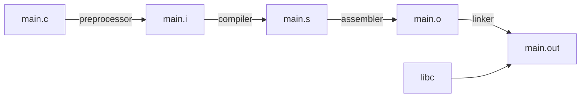

## Why C for embedded systems

C gives direct access to memory and hardware (pointers, bitwise operators, bit-fields, unions) while staying portable across compilers and architectures. That is why it is the main language for operating systems, device drivers, and firmware on ARM, AVR, PIC and similar microcontrollers.

## A short history

- Dennis Ritchie created C in 1972 at AT&T Bell Labs, on a PDP-11, while UNIX was being ported from the PDP-7.
- It borrowed ideas from B (Ken Thompson) and BCPL (Martin Richards). The first version is called K&R C.
- Standards keep the language portable: **C89** (ANSI), **C90** (the same standard adopted by ISO), **C99** (adds `bool`, `inline` and more), **C11** (adds threads), **C17** (technical corrections).

## Hello World

```c
#include <stdio.h>

int main(void)
{
    printf("Hello World\n");
    return 0;
}
```

```bash
gcc main.c -o main.out
./main.out
```

`printf()` is a library function declared in `stdio.h`. `main()` is the entry point, and its return value is the exit status given back to the operating system. Valid forms of `main` include `int main(void)` and `int main(int argc, char *argv[])`.

## The toolchain stages

`gcc` is a front end that runs a chain of tools for you.



| Stage | Tool | What it does | Command |
| --- | --- | --- | --- |
| Preprocess | `cpp` | Handles `#include` and `#define`, expands macros, removes comments | `gcc -E main.c -o main.i` |
| Compile | `cc1` | Checks syntax, translates C to assembly | `gcc -S main.c` gives `main.s` |
| Assemble | `as` | Translates assembly to machine code (object file) | `gcc -c main.c` gives `main.o` |
| Link | `ld` | Combines object files and library code into one executable | `gcc main.o -o main.out` |

For a program with several source files, compile each one separately and link them together:

```bash
gcc -c main.c
gcc -c fun.c
gcc main.o fun.o -o main.out
```

## Common mistakes

::: pitfall
Mixing up `-S` and `-c`. `-S` stops after compiling and gives assembly text (`.s`). `-c` stops after assembling and gives an object file (`.o`). Neither runs the linker.
:::

## Practice questions

1. Which tool removes comments and expands macros?

::: answer
The preprocessor (`cpp`), before the compiler sees the code.
:::

2. Why compile source files with `-c` in a larger project?

::: answer
Each file becomes its own `.o`, so only changed files need recompiling. The linker combines the objects at the end.
:::
