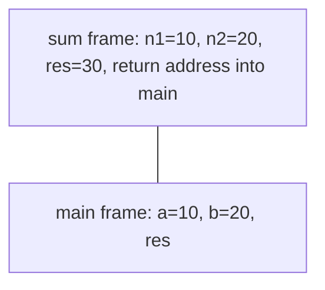

## Why functions

A function is a named block that performs one task. It gives you reusability, readability and maintainability. A C program has at least one function, `main()`, where execution begins.

## Declaration, definition, call

```c
int sum(int n1, int n2);        /* 1. declaration (prototype) */

int main(void)
{
    int a = 10, b = 20, res;
    res = sum(a, b);            /* 3. call: a, b are actual arguments */
    printf("%d\n", res);
    return 0;
}

int sum(int n1, int n2)         /* 2. definition: n1, n2 are formal arguments */
{
    int res;
    res = n1 + n2;
    return res;
}
```

- A **declaration** (prototype) tells the compiler the name, argument types and return type. It is not executed at runtime. Parameter names are optional: `void demo(int, int);`.
- A **definition** is the body that runs when the function is called.
- A function can return at most one value, and a function cannot be defined inside another function.
- Actual arguments are copied into formal arguments, and their types must match.

`int fun3();` and `int fun4(void);` differ: an empty parameter list in C means "unspecified arguments", while `(void)` means none. Prefer `(void)`.

## Function types

- **User-defined**: declared, defined and called by the programmer.
- **Library**: declared in headers (`stdio.h`, `math.h`), defined in libraries (`libc.so`, `libm.so`), called by the programmer.
- **`main()`**: the entry point, defined by the user but declared by the system.

## What happens on the stack

Each call creates a **function activation record** (also called a stack frame) on the stack of the process. It holds the local variables, the formal arguments and the return address. When the function finishes, its frame is destroyed and execution continues after the call.



The value returned by `sum` (30) goes back to the caller and is stored in `res` of `main`.

## Common mistakes

::: pitfall
Calling a function before it is declared. Older compilers assume it returns `int`, which gives wrong results for other return types. Always declare prototypes.
:::

::: pitfall
Returning the address of a local variable. The frame is destroyed on return, so the pointer dangles.
:::

## Practice questions

1. Where do local variables of a function live, and when are they destroyed?

::: answer
In the function's stack frame. They are created when the function is called and destroyed when it returns.
:::
