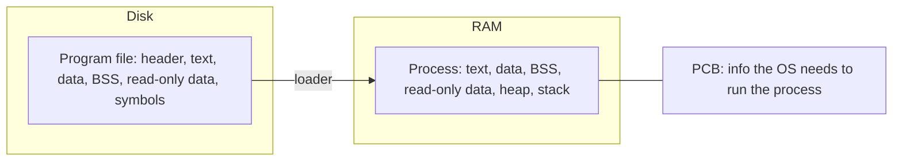

## A program is a file

An executable (`.out`, `.exe`) is a file organized into sections:

| Section | Contents |
| --- | --- |
| Executable header | information the OS needs to run it: a **magic number** identifying the format, the program type, the location and size of the other sections, and the address of the entry point (`main`) |
| Text | the instructions (machine code) |
| Data | initialized global and static variables |
| BSS | uninitialized global and static variables (only the size is stored, they start as zero) |
| Read-only data | string constants and `const` data |
| Symbol table | information about symbols (variables and functions), used by linkers and debuggers |

On Linux the format is **ELF** (the file starts with the bytes `0x7F 'E' 'L' 'F'`), on Windows it is **PE** (starts with `MZ`). GCC names its output `a.out` by default, although the format today is ELF.

Inspect an executable with `size a.out`, `readelf -S a.out`, `nm a.out` or `objdump -d a.out`.

## A process is a running program

When you run the program, the **loader** reads it from disk and builds a **process** in RAM. The process has the sections from the file plus two that exist only at runtime: the heap and the stack.

| Part | Holds |
| --- | --- |
| Stack | local variables and function frames (grows as functions are called) |
| Heap | memory from `malloc` |
| BSS | zero-initialized globals and statics |
| Data | initialized globals and statics |
| Read-only data | string literals, constants |
| Text | the program's code |

The operating system keeps a **process control block (PCB)** with everything needed to manage and execute the process.

::: note
On a microcontroller there is usually no OS and no loader. The linker places text and read-only data in Flash. A small startup routine copies initialized data from Flash into RAM and zeroes the BSS before `main()` runs.
:::

## Practice questions

1. Why does BSS take almost no space in the executable file?

::: answer
Its contents are all zeros, so the file stores only its size. The loader (or startup code) allocates and zeroes it.
:::
