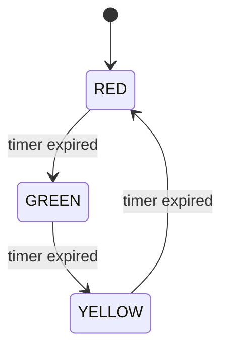

## The idea

A finite state machine (FSM) has a fixed set of **states**, **events**, and rules for which event moves it from one state to another. It is the standard way to structure embedded control logic because it is predictable and easy to test.

## The task

A traffic light with states RED, GREEN and YELLOW. Transitions happen on timer events. **No global variables.**



## Keeping state without globals

Put everything the machine needs inside a struct, and pass a pointer to it. Then you can even run several independent machines.

```c
#include <stdint.h>
#include <stdio.h>

typedef enum { STATE_RED, STATE_GREEN, STATE_YELLOW } light_state_t;
typedef enum { EVT_NONE, EVT_TIMER } event_t;

typedef struct {
    light_state_t state;
    uint32_t      ticks_in_state;
    uint32_t      duration[3];        /* ticks for RED, GREEN, YELLOW */
} traffic_t;

static void enter_state(traffic_t *t, light_state_t next)
{
    t->state = next;
    t->ticks_in_state = 0U;
    switch (next) {
        case STATE_RED:    puts("RED");    break;
        case STATE_GREEN:  puts("GREEN");  break;
        case STATE_YELLOW: puts("YELLOW"); break;
        default: break;
    }
}

void traffic_init(traffic_t *t)
{
    t->duration[STATE_RED]    = 5U;
    t->duration[STATE_GREEN]  = 4U;
    t->duration[STATE_YELLOW] = 2U;
    enter_state(t, STATE_RED);
}

void traffic_handle(traffic_t *t, event_t ev)
{
    if (ev != EVT_TIMER) { return; }

    t->ticks_in_state++;
    if (t->ticks_in_state >= t->duration[t->state]) {
        switch (t->state) {
            case STATE_RED:    enter_state(t, STATE_GREEN);  break;
            case STATE_GREEN:  enter_state(t, STATE_YELLOW); break;
            case STATE_YELLOW: enter_state(t, STATE_RED);    break;
            default:           enter_state(t, STATE_RED);    break;
        }
    }
}

int main(void)
{
    traffic_t light;
    traffic_init(&light);
    for (uint32_t tick = 0U; tick < 30U; tick++) {
        traffic_handle(&light, EVT_TIMER);   /* a real system calls this from a timer */
    }
    return 0;
}
```

`enter_state` is also the place for actions that happen **on entry**, such as switching the lamp outputs. On real hardware, `puts` becomes writes to GPIO registers.

## Design notes

- A `default` case in each `switch` recovers from an impossible state (for example after memory corruption).
- Table-driven FSMs (a 2D array of next states, or an array of function pointers, one per state) scale better when there are many states.
- Keep the event source separate: the timer interrupt only sets a flag or posts an event, and the main loop calls `traffic_handle`.

## Practice questions

1. How would you add a "pedestrian request" that shortens the GREEN time?

::: answer
Add an event such as `EVT_PEDESTRIAN`. In `traffic_handle`, when the state is GREEN and the event arrives, either move to YELLOW immediately or reduce the remaining duration.
:::
